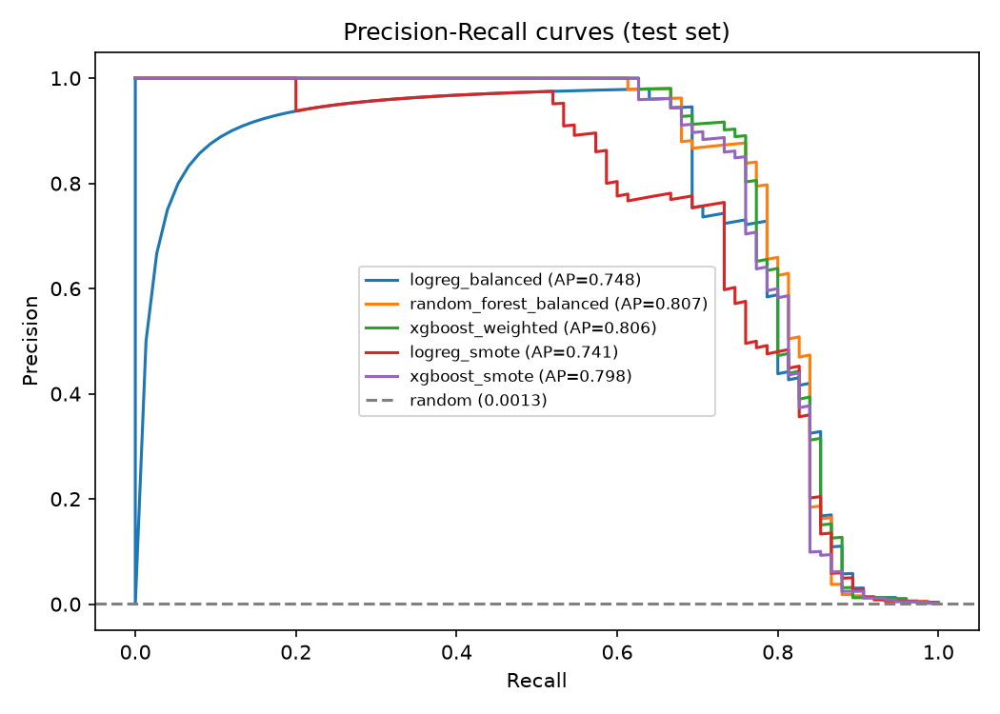

# Credit Card Fraud Detection

An end-to-end fraud-scoring project on the highly imbalanced Kaggle credit-card dataset: a
leakage-safe training pipeline, cost-based decision thresholds, honest evaluation, a FastAPI
scoring service with an approve / review / block decision, tests and CI.

## Why this is built the way it is

Only 0.17% of transactions are fraud, so accuracy and even ROC-AUC are misleading. The pipeline is
designed around how a bank would actually judge a fraud model:

- **Primary metric is PR-AUC** (average precision), with a bootstrap 95% confidence interval,
  because the test set contains only a few hundred fraud cases at most.
- **Time-based split by default**: train on the earliest transactions, validate on the next block,
  test on the latest block, mimicking deployment. A stratified split is available with `--split stratified`.
- **No leakage**: SMOTE runs *inside* an `imblearn` pipeline, so it only touches training data.
  Validation and test sets are never resampled. Class weighting is compared against SMOTE.
- **Cost-based threshold**: the alert threshold minimises *value of fraud missed + review cost per
  alert*, tuned on the validation set only, then reported on the untouched test set. The review cost
  is an assumption (`--review-cost`, default 5), not a measured figure.
- **Feature choices**: raw `Time` is dropped (it cannot generalise to future data) in favour of
  cyclical hour-of-day; `Amount` is log-transformed.
- **One feature module** is shared by training and the API, so serving cannot drift from training.

## Dataset

[Kaggle: Credit Card Fraud Detection](https://www.kaggle.com/datasets/mlg-ulb/creditcardfraud):
284,807 transactions, 492 fraudulent (~0.17%). Features `V1`-`V28` are anonymised PCA components.
The CSV is not in this repository; download it and place it at `data/creditcard.csv`.

## Results

<!-- RESULTS:START -->
Split: **time** | train 170,884 / val 56,961 / test 56,962 transactions | frauds in test: **75** | assumed review cost per alert: **5**

| Model | Val PR-AUC | Test PR-AUC | 95% CI | Test ROC-AUC | Precision | Recall | Alerts/10k txns | Fraud value caught % | Cost saving vs no model % |
|---|---|---|---|---|---|---|---|---|---|
| logreg_balanced | 0.757 | 0.748 | 0.629-0.853 | 0.981 | 0.96 | 0.64 | 8.8 | 60.3 | 57.0 |
| random_forest_balanced | 0.761 | 0.807 | 0.710-0.885 | 0.979 | 0.85 | 0.76 | 11.8 | 65.9 | 61.5 |
| xgboost_weighted | 0.784 | 0.806 | 0.711-0.881 | 0.972 | 0.92 | 0.72 | 10.4 | 52.4 | 48.6 |
| logreg_smote | 0.704 | 0.741 | 0.631-0.826 | 0.977 | 0.78 | 0.67 | 11.2 | 60.4 | 56.3 |
| xgboost_smote | 0.758 | 0.798 | 0.703-0.873 | 0.972 | 0.91 | 0.69 | 10.0 | 51.9 | 48.2 |

Selected model (best validation cost saving): **xgboost_smote**. Thresholds are tuned on the validation set only; all numbers above are on the held-out test set. The test set has few fraud cases, so read the confidence interval, not just the point estimate.


<!-- RESULTS:END -->

## Quick start

```bash
python -m venv .venv
source .venv/bin/activate          # Windows: .venv\Scripts\activate
pip install -r requirements-dev.txt

pytest -q                          # tests run on synthetic data, no download needed
python -m src.train --data data/creditcard.csv --update-readme
uvicorn src.api:app --reload       # then open http://127.0.0.1:8000/docs
python scripts/sample_request.py data/creditcard.csv
```

### API

`POST /predict` takes `Time`, `V1`-`V28`, `Amount` and returns a fraud probability and a decision:
`approve`, `review` (score above the cost-optimal threshold, routed to a human) or `block`
(the highest-scoring 30% of alerts, a policy setting stored at training time via `--block-share`;
override with the `BLOCK_THRESHOLD` environment variable).

### Threshold explorer (Streamlit)

An interactive app for the question a fraud team actually asks: *how many alerts can we afford to
review, and how much fraud does that catch?*

```bash
pip install -r requirements-app.txt
streamlit run app/explorer.py
```

It reads `reports/scores.csv.gz` (written by training) and lets you change the review cost, choose a
model, set the alert volume, and see precision, recall, fraud value caught and net saving on the test
set. It also splits transactions into approve / review / block and shows a demo review queue.
Thresholds are tuned on validation data and results are shown on held-out test data, as in training.

### Docker

```bash
python -m src.train --data data/creditcard.csv     # creates models/model.joblib
docker build -t fraud-api .
docker run -p 8000:8000 -v "$(pwd)/models:/app/models" fraud-api
```

## Project layout

```
src/data.py        loading, splitting, shared feature engineering
src/evaluate.py    PR-AUC bootstrap CI, cost-based threshold, plots
src/train.py       model comparison, selection, artifacts, README results
src/api.py         FastAPI service
src/explorer.py    tested logic behind the explorer (cost curves, decision bands)
app/explorer.py    Streamlit threshold explorer
tests/             pytest suite (synthetic data) | .github/workflows/ci.yml runs ruff + pytest
fraud_detection.ipynb   original exploratory notebook
```

## Limitations

- Features are anonymised and cover two days of European card transactions, so results will not
  transfer to another bank's data without retraining.
- The cost model uses an assumed review cost and treats `Amount` as the loss; real losses also
  include chargebacks, customer friction and investigation time.
- The fraud count in the test split is small, so differences between models can fall within the
  confidence interval.
- No drift monitoring or retraining schedule is implemented.
